# CarnetDeBord.app

Application web pour noter et suivre mes trajets de chauffeur routier (France et Europe) : étapes de la journée, lettres de voiture, carburant, repos, frais, cartes et statistiques. Pensée pour le téléphone, consultable sur PC.

👉 **https://mrxely.github.io/CarnetDeBord.app/**

<p align="center">
  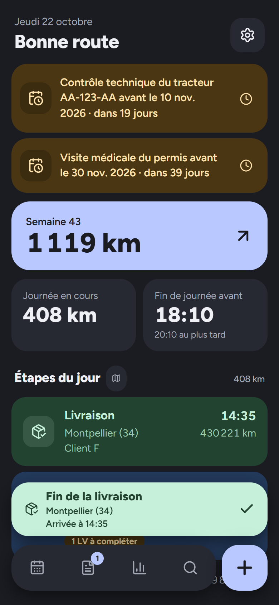
  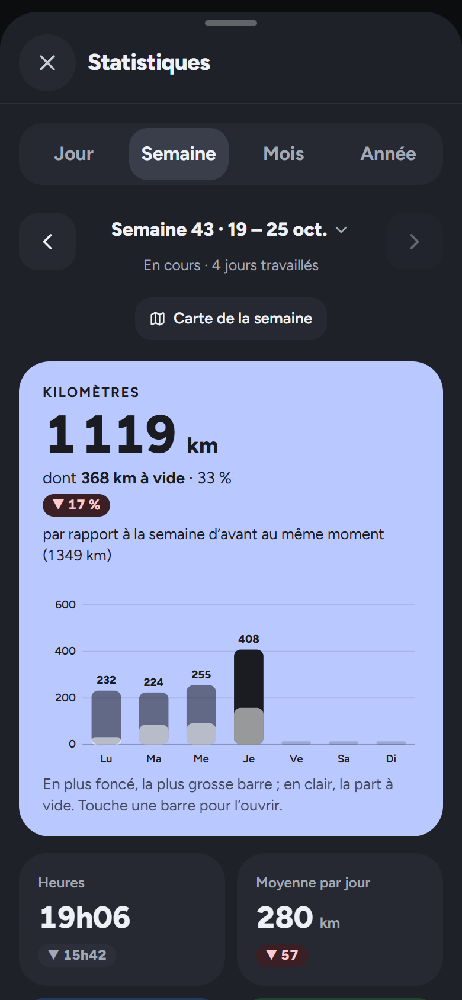
  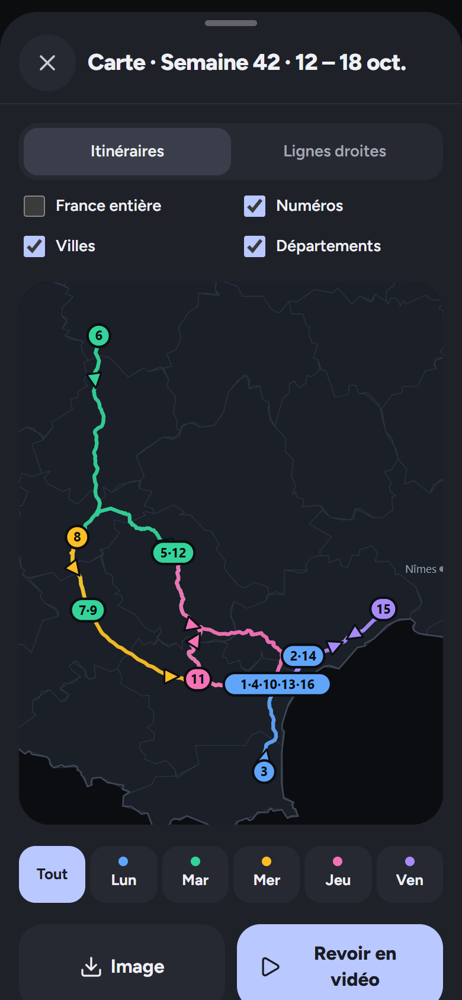
</p>

> Les captures utilisent des données inventées (villes publiques, « Client A », fausses plaques). Elles sont faites au format téléphone, avec le mode démo.

## Fonctionnalités

### L'accueil et la semaine

- Style **« grandes tuiles »** sur fond sombre : une couleur par type d'étape (chargement bleu, livraison vert, carburant ambre), gros boutons faciles à toucher, le plus récent en premier.
- **Accueil = la journée en cours** : km du jour, **heure limite** de fin de journée (« avant 17:20 » pour 11 h de repos, en orange dans la dernière heure, en rouge après) ou amplitude une fois la journée finie, puis les étapes du jour. Avant la première étape, les **LV encore dans le camion** (« Livraison prévue à … »).
- **Rappels des échéances** en haut de l'accueil (carte conducteur, FCO, visite médicale, contrôles techniques, chrono), à repousser d'une semaine d'un toucher.
- **Tuile de la semaine** (km) : elle ouvre la page Semaine avec tous les jours, les **LV dans le camion**, les **frais**, la **carte** et la **feuille de semaine en PDF**. La semaine commence le dimanche à 22h ; ses km sont la somme des trajets entre deux relevés du même tracteur, comme dans les Statistiques.
- **Glisser du doigt** pour changer de semaine, ou toucher le titre pour **choisir une semaine** (liste groupée par mois, avec la carte de chaque semaine et du mois) ou aller à une date.
- **Sur PC** (écran large) : menu à gauche, la semaine au centre, sa carte et les LV du camion à droite.

<p align="center">
  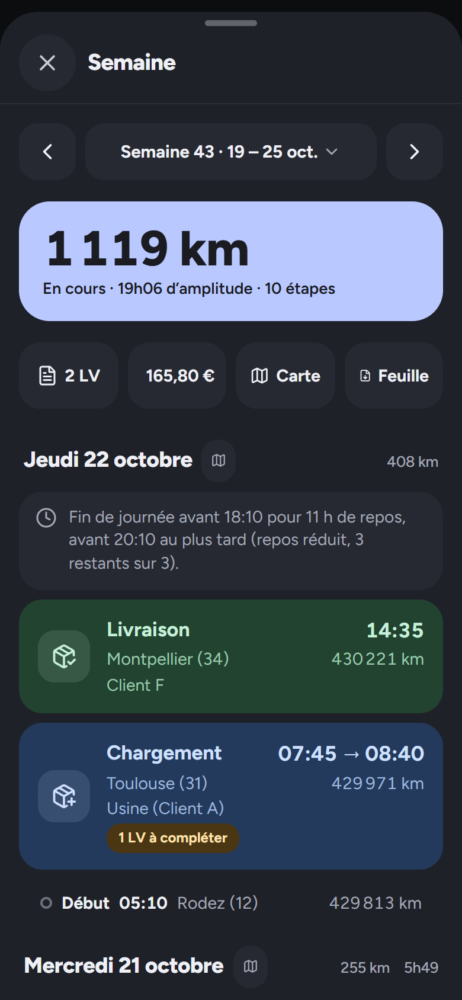
  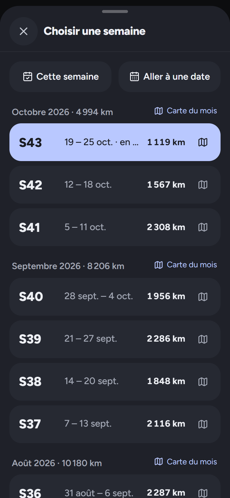
  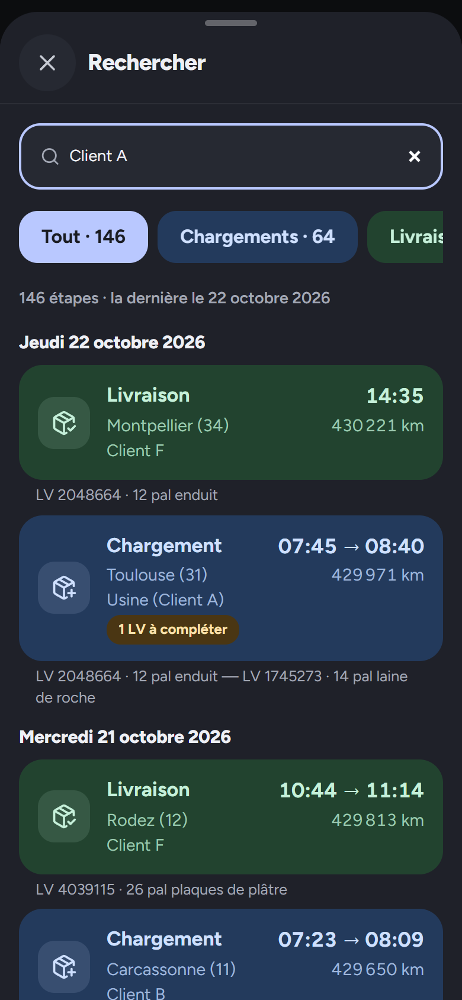
</p>

- **Recherche** (loupe de la barre du bas) dans toutes les étapes et leurs LV : ville, client, n° de LV, marchandise, plaque, km… Toucher un résultat l'affiche dans sa semaine.

### Les étapes

<p align="center">
  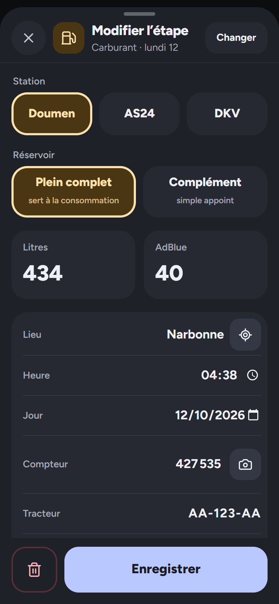
  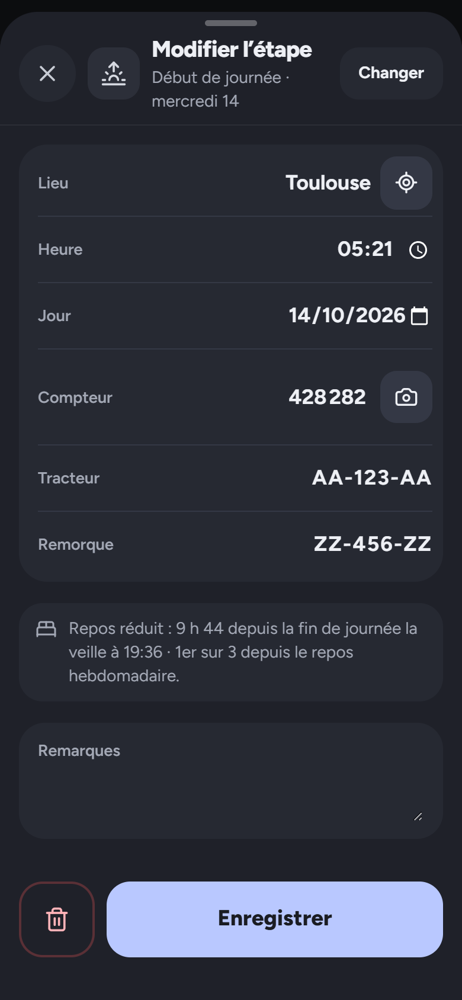
</p>

- **Bouton « + »** : début de journée, chargement, livraison, carburant ou fin de journée. Le type le plus probable est déjà choisi d'après la dernière étape (livraison après un chargement, début de journée après une fin…).
- **Fin du chargement ou de la livraison** : l'étape se note en arrivant ; un bouton au-dessus de la barre du bas enregistre l'heure de fin d'un seul appui (la carte de l'étape montre « 08:12 → 09:40 »). Le même bouton peut s'afficher dans une **notification**, sans ouvrir l'appli (réglage des Options, avec Chrome).
- **Immatriculations** du tracteur et de la remorque reprises de la saisie précédente ; le **début de journée** reprend le lieu et le km de la fin de journée précédente.
- **Lieu** par GPS ou par recherche avec suggestions (département et pays ajoutés automatiquement). Mode Europe dans les Options.
- **Kilométrage en photo** : une photo de l'écran du chrono (ou du compteur) remplit le km. Alerte si le km est plus petit que le dernier relevé ou s'il y a plus de 2000 km d'écart.
- **Carburant** : station (Doumen, AS24, DKV), litres de gasoil et d'AdBlue, et interrupteur **« Plein complet »** (allumé d'office chez Doumen, éteint pour les compléments AS24 et DKV).

### Le repos (RSE)

- Au **début de journée**, un bandeau vérifie le repos depuis la fin de journée précédente : gris si tout va bien, orange à surveiller, rouge en cas d'infraction. Il suit les règles du règlement européen : repos journalier de 11 h (ou 9 h réduit, 3 fois au plus), repos hebdomadaire de 45 h (ou 24 h réduit), repos pris dans les 24 h, rattrapage des repos hebdomadaires réduits.
- À la **fin de journée** : l'heure de reprise au plus tôt, et une alerte si la journée dépasse 13 h ou 15 h.
- Un petit triangle signale un repos à revoir. C'est un repère : le chrono fait foi (les pauses ne sont pas notées, donc le repos fractionné n'est pas pris en compte).

### Les lettres de voiture (LV)

<p align="center">
  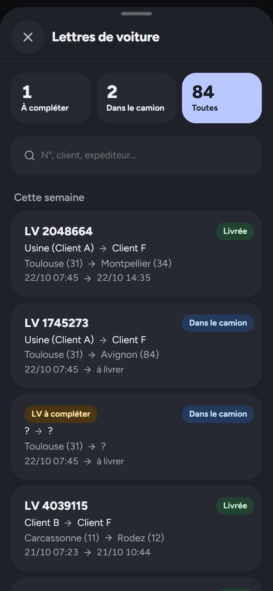
</p>

- **Plusieurs LV par chargement** ; un nouveau chargement reçoit d'office une LV vide, à compléter plus tard (bouton « Scanner la lettre de voiture »).
- À la livraison, on coche les LV **« dans le camion »** qui sont livrées.
- **Photo de la LV et lecture automatique** : l'appli lit le numéro, l'expéditeur, le destinataire, la marchandise et le poids (Claude Haiku, avec un bouton « Relire en mode fiable »). La lecture s'affiche en direct sous la photo, avec un bouton « Détails ». Les champs remplis par la lecture sont marqués « LU » (en orange si l'IA n'est pas sûre).
- **Page LV** avec trois onglets (à compléter, dans le camion, toutes : on glisse de l'un à l'autre) et recherche. La fiche d'une LV s'ouvre en lecture, avec un bouton « Modifier ». Changer la ville ou la date de chargement depuis une LV change l'étape correspondante.

### Les frais de déplacement et la feuille de semaine

<p align="center">
  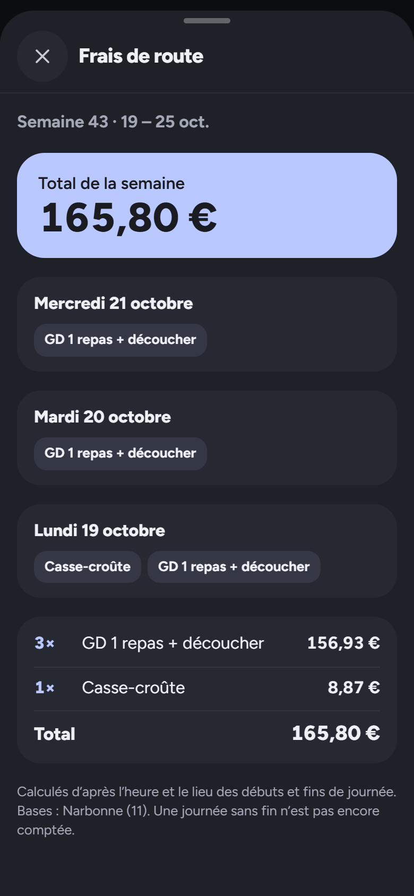
</p>

- **Frais de route** calculés par journée d'après l'heure et le lieu des débuts et fins de journée : grand déplacement (1 ou 2 repas + découcher), repas, casse-croûte, repas de nuit, prime de départ du lundi, tarif étranger. Bases (domicile, dépôt) et tarifs dans les Options.
- **Feuille de semaine en PDF** : la feuille papier de l'entreprise redessinée et remplie (départs de chaque jour, chargements et livraisons avec une ligne par LV, pleins de carburant). Partagée depuis le téléphone, téléchargée sur PC.

### La consommation de gasoil

- Calculée **d'un plein complet au suivant**, tracteur par tracteur : tous les litres mis entre deux pleins complets, compléments compris, divisés par les km parcourus. Les compléments de 200 à 300 L ne faussent donc rien.
- Une **semaine sans plein a quand même consommé** : chaque km prend la consommation de l'intervalle entre pleins qui le contient, ou la consommation habituelle (moyenne des 4 derniers pleins) s'il n'y a pas encore eu de plein complet après.
- Affichée sur la carte de chaque plein complet (« 26,1 L/100 km depuis le plein du 5 oct. ») et dans les Options.

### Les cartes

<p align="center">
  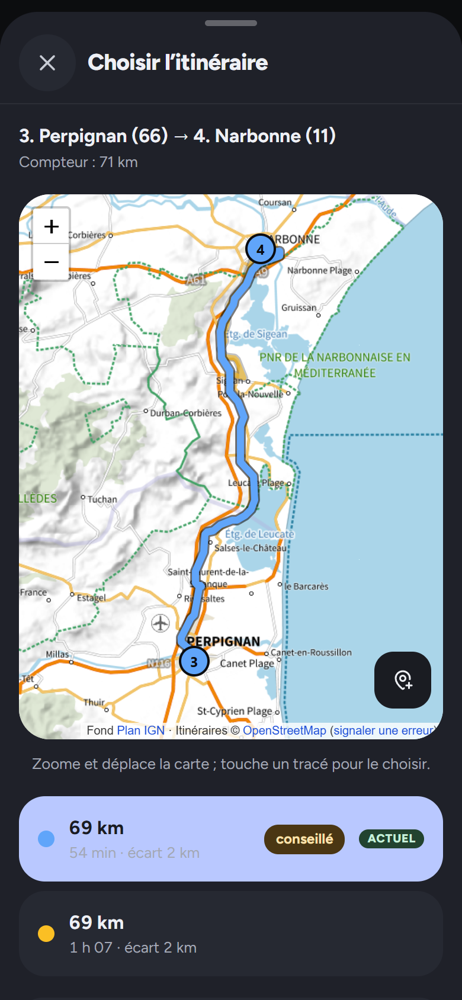
  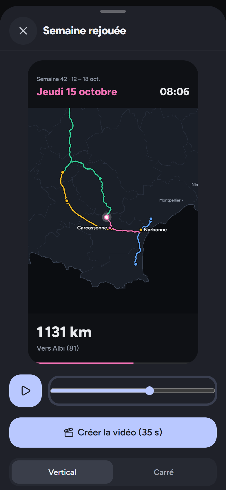
</p>

- **Carte de la semaine** : les étapes reliées jour par jour, une couleur par jour, avec les km de chaque journée. Les itinéraires routiers sont calculés une seule fois puis enregistrés, trajet par trajet, en gardant celui dont la longueur est la plus proche des km du compteur. Lignes droites au choix.
- **Choisir l'itinéraire** d'un trajet sur une carte qu'on peut zoomer (fond Plan IGN) : itinéraires proposés avec leur écart au compteur, passage par une ou plusieurs villes, ou point de passage posé à la main.
- **Carte d'une journée** (petite pastille à côté du jour) et **carte du mois** (une couleur par semaine).
- **Semaine rejouée** (bouton « Revoir en vidéo » sous la carte) : animation des trajets dans l'ordre, avec le camion, les villes atteintes, les arrêts et les repos. Aussi pour une journée ou un mois. Format vertical ou carré, de 15 à 120 s, et **création d'une vidéo MP4** à partager, fabriquée dans le téléphone (avec Chrome).
- Export de la carte en image.

### Les statistiques

<p align="center">
  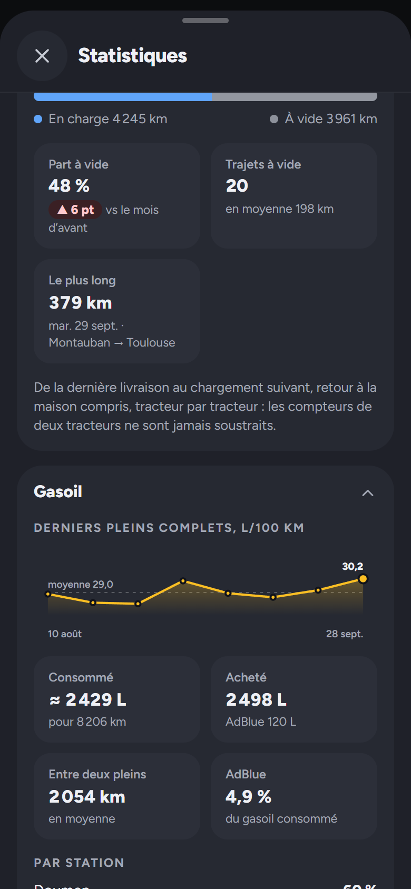
  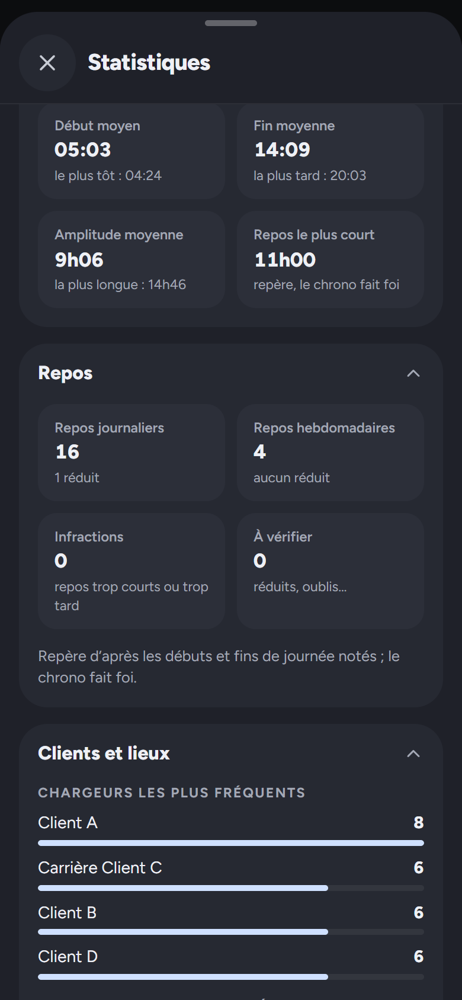
  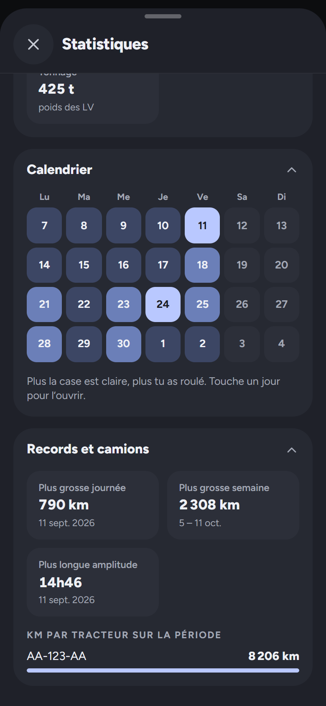
</p>

- Par **jour, semaine, mois ou année**, avec les flèches ou en glissant du doigt. Toucher le titre pour aller directement à une date ; bouton pour ouvrir la carte de la période.
- **Km de la période** comparés à la période d'avant (au même moment si la période est en cours).
- **Tuiles** : heures, moyenne par jour, chargements, livraisons, gasoil consommé et acheté, consommation en L/100 km, frais de route.
- **Barres des km** par jour, semaine ou mois, avec la part à vide en gris : toucher une barre ouvre la période.
- **Km à vide** : de la dernière livraison au chargement suivant (retour à la maison compris). Part des km, comparaison avec la période d'avant, nombre de trajets à vide, le plus long, détail par tracteur.
- **Gasoil** : courbe des derniers pleins complets, répartition par station, AdBlue.
- **Temps de travail** : début et fin moyens, amplitude, repos le plus court.
- **Repos** : repos journaliers et hebdomadaires (dont réduits), infractions, points à vérifier et rattrapages à faire.
- **Clients et lieux** : chargeurs et destinataires les plus fréquents (un nom qui contient un autre client, comme « Usine (Client A) », est compté avec lui), départements, tonnage.
- **Calendrier du mois** en couleurs, **records** (plus grosse journée, plus grosse semaine, plus longue amplitude) et km par tracteur.
- **Vue Jour** : les étapes de la journée dans l'ordre et le repos qui l'a précédée.

<p align="center">
  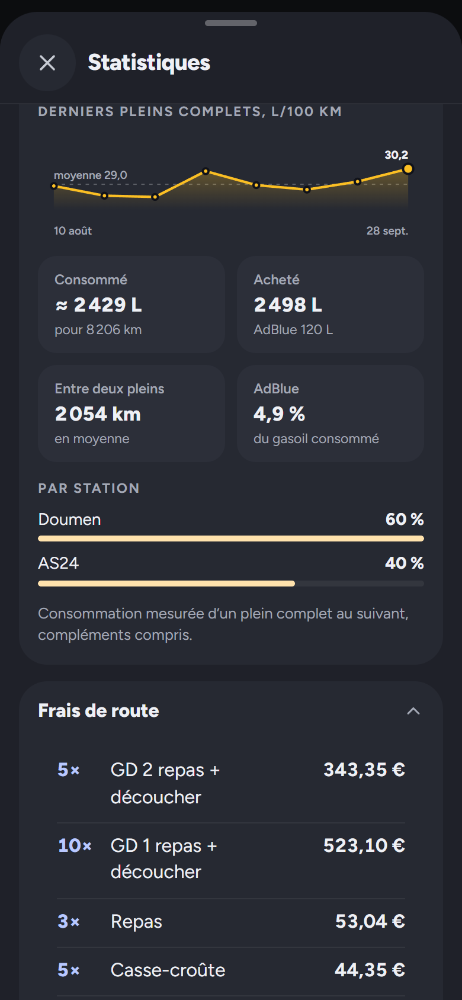
  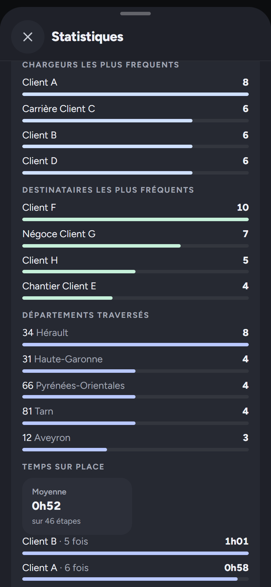
</p>

### Et aussi

<p align="center">
  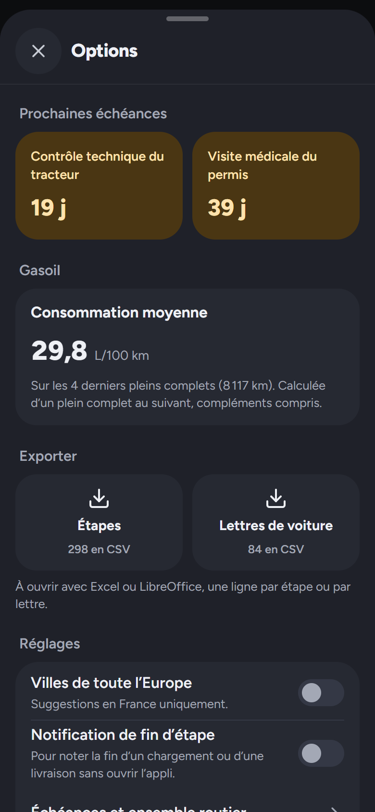
</p>

- **Échéances** dans les Options : date du dernier passage de la carte conducteur, de la FCO, de la visite médicale, des contrôles techniques du tracteur et de la remorque et de l'étalonnage du chrono ; la prochaine échéance est calculée.
- **Fonctionne sans réseau** : les saisies restent dans le téléphone et partent dès que le réseau revient.
- **Synchronisé** entre téléphone et PC grâce à Supabase.
- **Exports CSV** (étapes et lettres de voiture), à ouvrir avec Excel ou LibreOffice.
- **Compteur des lectures automatiques** du mois dans les Options (limites : 2 par photo, 30 par jour, 300 par mois).
- **Installable** sur l'écran d'accueil du téléphone, comme une vraie appli.

## Technique

React 19, Vite, TypeScript, PWA. Données dans [Supabase](https://supabase.com) (tables protégées par utilisateur, stockage privé des photos, fonction Edge `read-waybill` qui lit les LV et le km avec Claude). Lieux via [Photon](https://photon.komoot.io) (OpenStreetMap) et [geo.api.gouv.fr](https://geo.api.gouv.fr), itinéraires via [Valhalla](https://valhalla1.openstreetmap.de) (FOSSGIS) et [OSRM](https://project-osrm.org) en secours, fond de carte [Plan IGN](https://cartes.gouv.fr) avec Leaflet. PDF avec jsPDF, vidéos avec [Mediabunny](https://mediabunny.dev) (WebCodecs). Mise en ligne automatique sur GitHub Pages à chaque envoi sur `main`.

## Mise en place (une seule fois)

1. Créer un projet gratuit sur [supabase.com](https://supabase.com).
2. Dans **SQL Editor**, coller et lancer (**Run**) dans l'ordre : [supabase/schema.sql](supabase/schema.sql), puis les fichiers de [supabase/migrations/](supabase/migrations/) (`002` à `013`).
3. Copier l'URL du projet (bouton **Connect**) et la clé **publishable** (**Settings → API Keys**) dans [src/config.ts](src/config.ts).
4. Dans **Authentication → Sign In / Providers → Email**, désactiver **Confirm email** (et les inscriptions une fois son compte créé).
5. Pour la lecture automatique : ajouter le secret `ANTHROPIC_API_KEY` dans **Edge Functions → Secrets**, puis déployer la fonction :
   `npx supabase functions deploy read-waybill --project-ref <projet> --use-api`.
6. Sur GitHub, dans **Settings → Pages**, choisir **Source : GitHub Actions**.

## Installer sur le téléphone

Ouvrir l'adresse de l'appli, puis :
- **Android (Chrome)** : menu ⋮ → *Ajouter à l'écran d'accueil*. Chrome est conseillé : il sait partager les PDF et les vidéos (Firefox Android ne partage pas de fichiers).
- **iPhone (Safari)** : bouton Partager → *Sur l'écran d'accueil*.

## Développement

```sh
npm install         # installer les dépendances
npx vite --host     # lancer l'appli en local, en https (accessible depuis le téléphone sur le même Wi-Fi)
npm test            # lancer les tests
npm run build       # vérifier TypeScript et compiler la version de production
```

Le serveur local utilise un certificat fait maison : accepter l'avertissement du navigateur la première fois. Le https est nécessaire sur le téléphone (GPS).

Pour tester les notifications (Chrome refuse le service worker avec ce certificat) : `HTTP=1 npx vite`, puis http://localhost:5173/CarnetDeBord.app/ sur le PC, ou le téléphone relié en USB avec la redirection de port de `chrome://inspect`.

## Mode démo (tests en local)

Pour tester avec un historique réaliste sans toucher aux vraies données :

1. Convertir une sauvegarde de l'ancien projet : `node scripts/import-legacy.mjs <truck-manager-backup.json>`. Le résultat va dans `data/demo-events.json`, dossier jamais publié. On peut aussi y mettre le fichier du bouton « Sauvegarder la démo » des Options (étapes, LV et réglages).
2. Lancer l'appli et ouvrir `https://localhost:5173/CarnetDeBord.app/?demo`. Ajouter `?demo=reset` pour recharger les données d'origine.

En mode démo, tout reste dans le navigateur : rien n'est envoyé à Supabase. Ce mode n'existe pas dans la version en ligne.
